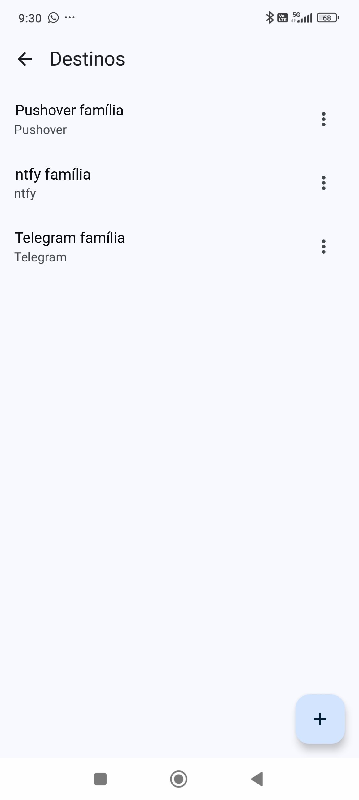
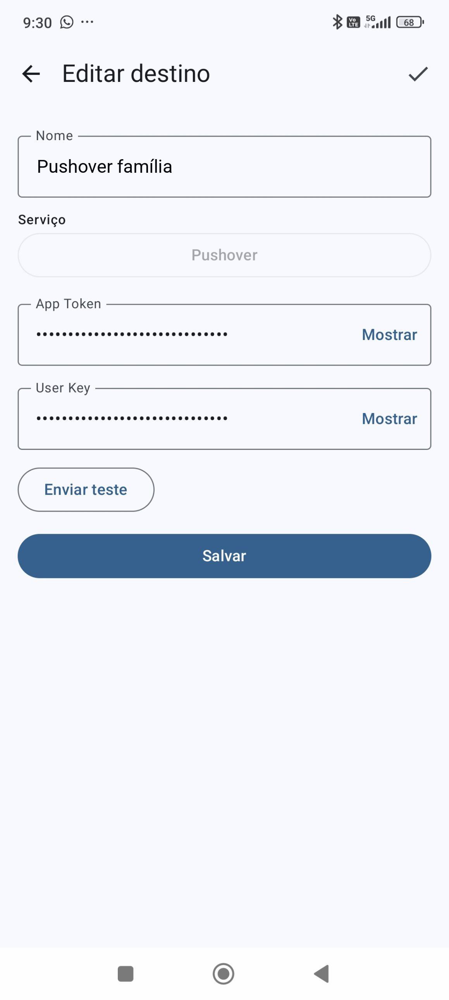
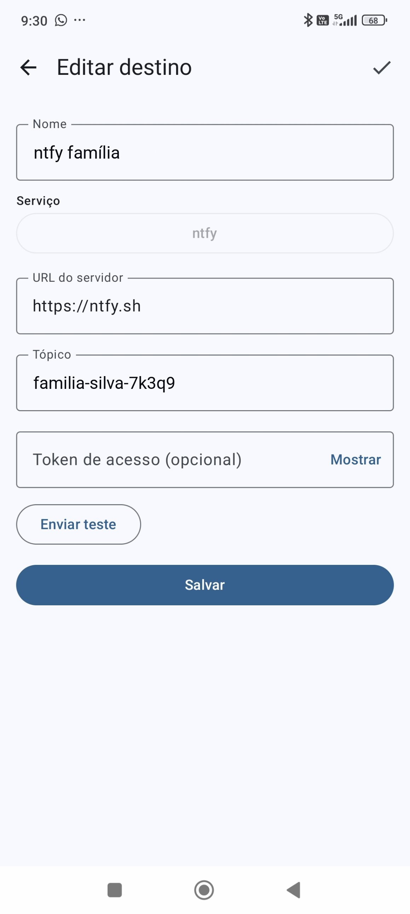
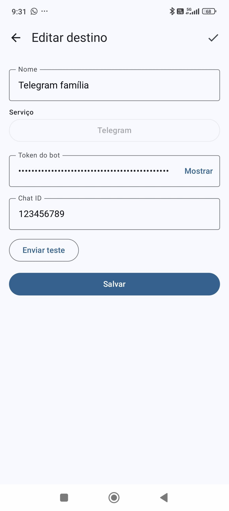
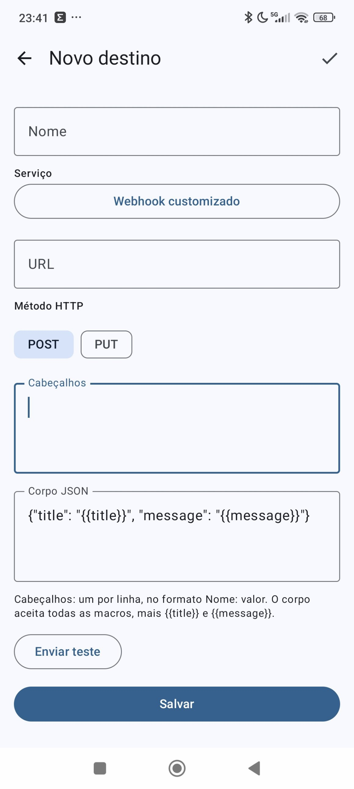



# Destinos

Um destino é um serviço de envio já configurado com as suas credenciais. Você cadastra o destino uma vez e usa em quantos botões quiser.

Para gerenciar destinos, abra **Configurações > Destinos**. Ali você cria, edita, duplica e exclui. Os campos de credencial aparecem mascarados, com a opção **Mostrar**. Ao excluir um destino em uso, o app avisa quais botões perdem notificações.

{: style="width:100%;max-width:280px"}

Depois de preencher as credenciais, use sempre **Enviar teste**. Ele dispara a mensagem "Mensagem de teste do PressVibe" e mostra o resultado na hora.

## Qual serviço escolher

| Serviço | Custo para quem recebe | Prioridade | Toca no silencioso |
|---|---|---|---|
| Pushover | App pago após o período de teste | Sim, 5 níveis | Sim, na prioridade Emergência |
| ntfy | Gratuito | Sim, 5 níveis | Sim, se o receptor liberar |
| Telegram | Gratuito | Não | Não |
| Webhook | Depende do sistema de destino | Não | Depende do sistema |

Para alertas de emergência, prefira o Pushover ou o ntfy. São os únicos com prioridade, o que permite o alerta tocar com o celular de quem recebe no silencioso.

## Pushover

O Pushover tem o recurso mais forte para emergência: a prioridade Emergência repete o alerta até alguém confirmar o recebimento.

1. Quem vai receber cria uma conta em [pushover.net](https://pushover.net) e instala o app Pushover no celular.
2. Depois do login no site, a **User Key** aparece no painel. Ela identifica quem recebe.
3. Em [pushover.net/apps/build](https://pushover.net/apps/build), crie uma aplicação com o nome PressVibe. O site mostra o **API Token** dela.
4. No PressVibe, crie o destino do tipo Pushover e preencha **App Token** e **User Key**.

{: style="width:100%;max-width:280px"}

Para avisar várias pessoas de uma vez, crie um grupo de entrega no Pushover e use a chave do grupo no lugar da User Key.

Para o alerta de prioridade Alta ou Emergência tocar com o celular no silencioso, no vibrar ou no Não perturbe, quem recebe precisa ajustar o app Pushover. O passo a passo está em [Pushover tocando no silencioso](../pushover-silencioso/).

## ntfy

O ntfy é gratuito e não pede cadastro. As mensagens vão para um tópico, e quem assina o tópico recebe.

1. Quem vai receber instala o app ntfy e assina um tópico com nome longo e aleatório.
2. No PressVibe, crie o destino do tipo ntfy. A **URL do servidor** já vem com `https://ntfy.sh`.
3. Preencha o **Tópico** com o mesmo nome.
4. Se você usa servidor próprio, troque a URL. Se o tópico exige login, preencha o **Token de acesso**.

{: style="width:100%;max-width:280px"}

Para o alerta de prioridade Emergência tocar com o celular no silencioso, no vibrar ou no Não perturbe, quem recebe precisa ajustar o app ntfy. O passo a passo está em [ntfy tocando no silencioso](../ntfy-silencioso/).

## Telegram

O Telegram envia a mensagem por um bot seu. O título e a mensagem chegam juntos, em duas linhas.

1. No Telegram, abra uma conversa com o **@BotFather** e mande `/newbot`. Siga as instruções e copie o token que ele devolve.
2. Quem vai receber abre uma conversa com o seu bot e manda `/start`. Um bot não inicia conversa sozinho.
3. Para descobrir o Chat ID, abra no navegador o endereço abaixo, trocando `TOKEN` pelo token do bot, e procure o número em `"chat":{"id":...}`.

```
https://api.telegram.org/botTOKEN/getUpdates
```

4. No PressVibe, crie o destino do tipo Telegram e preencha **Token do bot** e **Chat ID**.

{: style="width:100%;max-width:280px"}

Para avisar um grupo, adicione o bot ao grupo e mande uma mensagem lá. O Chat ID de um grupo começa com o sinal de menos.

O passo a passo completo, com exemplos, erros comuns e o envio para grupos, está em [Criar o bot do Telegram](../telegram-bot/).

## Webhook customizado

O webhook envia uma requisição HTTP para qualquer sistema que aceite JSON, como Home Assistant, Discord, Slack ou um servidor seu.

| Campo | Como preencher |
|---|---|
| URL | Endereço que recebe a requisição |
| Método HTTP | `POST` ou `PUT` |
| Cabeçalhos | Um por linha, no formato `Nome: valor` |
| Corpo JSON | Modelo do corpo, com macros |

{: style="width:100%;max-width:280px"}

O corpo já vem com um modelo que manda o título e a mensagem:

```json
{"title": "{{title}}", "message": "{{message}}"}
```

O corpo aceita todas as [macros](../macros/), mais `{{title}}` e `{{message}}`, que recebem o título e a mensagem da notificação já resolvidos. O app escapa os valores para o JSON continuar válido. Qualquer resposta HTTP 2xx conta como sucesso.

Exemplo para um webhook do Discord:

```json
{
  "content": "**{{title}}**\n{{message}}"
}
```

Exemplo com cabeçalho de autenticação para um servidor seu:

```
Authorization: Bearer seu-token-aqui
```

Se a URL começar com `http://`, o app avisa que a mensagem e as credenciais vão trafegar sem criptografia e pede confirmação.

