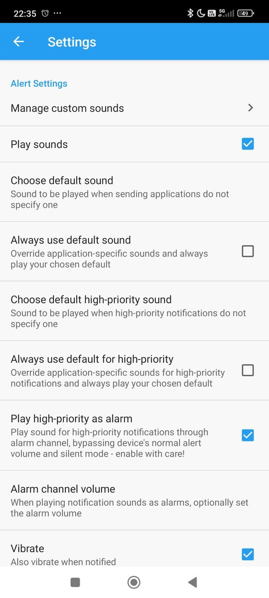
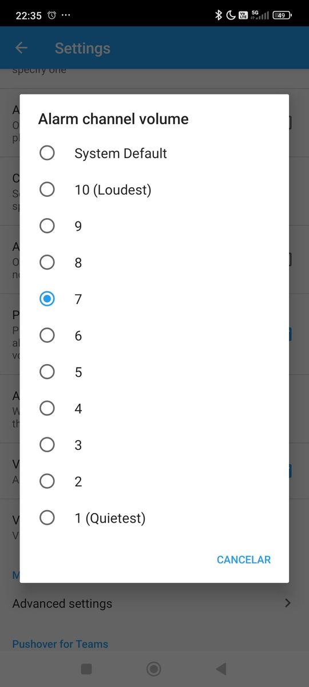
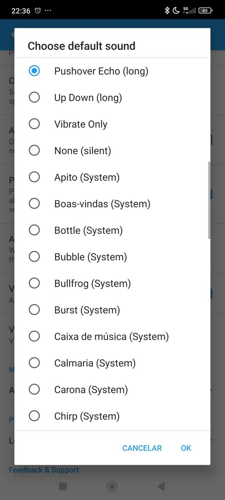
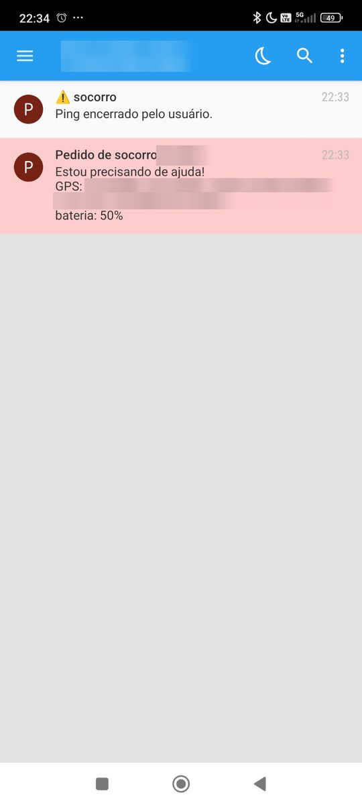

# Pushover tocando no silencioso

Este guia é para quem **recebe** os alertas pelo Pushover. A configuração é feita no celular dessa pessoa, no app Pushover. O PressVibe só precisa mandar com a prioridade certa.

Para criar o destino Pushover no PressVibe (App Token e User Key), veja [Destinos](../destinos/#pushover).

## Como funciona

O Android controla o som de notificações e o som de alarmes de forma separada. No silencioso ou no vibrar, as notificações ficam mudas, mas o despertador continua tocando.

O app Pushover tem uma opção que toca as mensagens de alta prioridade pelo canal de alarme do Android. Assim o alerta ignora o volume de notificação e o modo silencioso.

## No PressVibe (quem envia)

Na notificação do botão, use o destino Pushover com a prioridade **Alta** ou **Emergência**. As duas contam como alta prioridade no Pushover e tocam como alarme. A Emergência também repete o alerta até alguém confirmar o recebimento. Para pedido de socorro, use Emergência.

As prioridades Normal, Baixa e Mínima seguem o volume de notificação e ficam mudas no silencioso.

## No celular de quem recebe

O app Pushover está em inglês, e os nomes abaixo são os da tela dele. Nas telas do Android, o texto e o caminho dos menus mudam conforme o fabricante, a versão do Android e o idioma do aparelho. Se não achar uma opção com o mesmo nome, procure a de sentido parecido. A busca das Configurações do Android também ajuda: digite "Não perturbe", "Modos" ou "Bateria".

### No app Pushover

1. Instale o app Pushover e entre com a conta cuja **User Key** está no destino do PressVibe.
2. Toque no menu e abra **Settings**. As opções de som ficam na seção **Alert Settings**:

   {: style="width:100%;max-width:280px"}

3. Deixe **Play sounds** marcado.
4. Marque **Play high-priority as alarm**. É a opção que toca o alerta pelo canal de alarme, ignorando o volume de notificação e o modo silencioso.
5. Toque em **Alarm channel volume** e escolha o volume do alerta. Com **System Default**, o alerta segue o volume do despertador do celular. Com um número de 1 a 10, o Pushover usa esse volume, mesmo que o despertador esteja baixo. Para emergência, escolha um valor alto.

   {: style="width:100%;max-width:280px"}

6. Em **Choose default high-priority sound**, escolha o som dos alertas de alta prioridade. Ele vale quando a notificação do PressVibe não define um som no campo **Som**. Prefira um som longo, marcado como "(long)", que chama mais atenção. Evite **Vibrate Only** e **None (silent)**.

   {: style="width:100%;max-width:280px"}

   Se marcar **Always use default for high-priority**, o Pushover ignora o som definido no PressVibe e toca sempre o som escolhido aqui.

### Nas configurações do Android

7. Abra o Não perturbe (em alguns celulares, Modos, Foco ou Modo silencioso). Adicione o Pushover aos apps permitidos e confira se os **alarmes** estão permitidos.
8. Tire o Pushover da otimização de bateria. No Android padrão, o caminho é Configurações, Apps, Pushover, Bateria, **Sem restrições**. Em outros aparelhos a opção pode se chamar "Não otimizar" ou "Permitir atividade em segundo plano". Assim o Android não atrasa a entrega com a tela desligada.

## Como o alerta chega

No app Pushover, a mensagem de Emergência aparece destacada em vermelho até alguém confirmar. Se o botão usar o [Ping](../ping/), as mensagens seguintes aparecem na mesma lista. No exemplo abaixo, a última mensagem avisa que o Ping foi encerrado.

{: style="width:100%;max-width:280px"}

## Teste antes de precisar

Faça o teste com o botão real, com prioridade Emergência, em três situações no celular de quem recebe:

| Situação do celular | Resultado esperado |
|---|---|
| Som normal | Toca e repete até alguém confirmar |
| Vibrar | Toca no volume escolhido em Alarm channel volume |
| Silencioso ou Não perturbe | Toca no volume escolhido em Alarm channel volume |

Depois do teste, confirme o alerta no app Pushover ou toque em **Cancelar alerta** no [histórico do PressVibe](../botoes/#prioridades) para parar a repetição.

Se não tocar em alguma das situações, revise os passos 4, 5 e 7. Alguns fabricantes alteram o comportamento do som de alarme. Se o seu celular for um desses, use também o ntfy no mesmo botão. Veja [ntfy tocando no silencioso](../ntfy-silencioso/).
